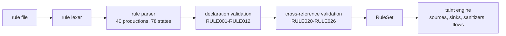

# The CodeTrace rule language

CodeTrace does not hard-code "sources", "sinks" or "sanitizers" in Python. They
are declared in a small declarative language that is itself parsed by the
project's own LR(1) parser generator: the same table-driven machinery, with its
own grammar, its own `FIRST`/`FOLLOW` sets and its own conflict report. A rule
file is **data**: it is parsed, validated and interpreted. It is never imported
and never executed, and the validator contains no `eval`, `exec`, `compile` or
`__import__` call (see `tests/test_rules.py`).

* grammar size: 40 productions, 78 LALR states, **0 conflicts**
  (`GET /api/rules` reports the same numbers at runtime)
* built-in rule set: `codetrace/rules/builtin/standard.ctrule`,
  version label `builtin-3387b7dcd97a95f3` — 5 sources, 8 sinks, 5 sanitizers,
  2 validators, 4 enabled flows
* validation entry points: `POST /api/rules/validate`, the *Rule Editor* page,
  and `codetrace.rules.rule_language.parse_and_validate`

## 1. Grammar as implemented

The listing below is generated from the running implementation, so it is exactly
what the parser accepts:

```bash
python3 -c "from codetrace.rules.rule_language import rule_tables as t; \
            [print(p.display()) for p in t().grammar.productions]"
```

| # | Production |
| --- | --- |
| 0 | `rule_file' -> rule_file` |
| 1 | `rule_file -> decl_list` |
| 2 | `decl_list -> decl_list decl` |
| 3 | `decl_list -> ε` |
| 4 | `decl -> KW_VERSION INT_LIT` |
| 5 | `decl -> KW_SOURCE IDENT LBRACE item_list RBRACE` |
| 6 | `decl -> KW_SINK IDENT LBRACE item_list RBRACE` |
| 7 | `decl -> KW_SANITIZER IDENT LBRACE item_list RBRACE` |
| 8 | `decl -> KW_VALIDATOR IDENT LBRACE item_list RBRACE` |
| 9 | `decl -> KW_FLOW IDENT LBRACE item_list RBRACE` |
| 10 | `item_list -> item_list item` |
| 11 | `item_list -> ε` |
| 12 | `item -> KW_FUNCTION IDENT` |
| 13 | `item -> KW_ARGUMENT signed_int` |
| 14 | `item -> KW_ARGUMENTS int_list` |
| 15 | `item -> KW_CONTEXT context_value` |
| 16 | `item -> KW_CONTEXTS context_list` |
| 17 | `item -> KW_DESCRIPTION STRING_LIT` |
| 18 | `item -> KW_CATEGORY STRING_LIT` |
| 19 | `item -> KW_SEVERITY IDENT` |
| 20 | `item -> KW_TAGS tag_list` |
| 21 | `item -> KW_RETURNS` |
| 22 | `item -> KW_ENABLED bool_value` |
| 23 | `item -> KW_SOURCES id_list` |
| 24 | `item -> KW_SINKS id_list` |
| 25 | `item -> KW_SANITIZERS id_list` |
| 26 | `signed_int -> INT_LIT` |
| 27 | `signed_int -> MINUS INT_LIT` |
| 28 | `int_list -> signed_int` |
| 29 | `int_list -> int_list COMMA signed_int` |
| 30 | `context_value -> IDENT` |
| 31 | `context_value -> STAR` |
| 32 | `context_list -> context_value` |
| 33 | `context_list -> context_list COMMA context_value` |
| 34 | `id_list -> IDENT` |
| 35 | `id_list -> id_list COMMA IDENT` |
| 36 | `tag_list -> STRING_LIT` |
| 37 | `tag_list -> tag_list COMMA STRING_LIT` |
| 38 | `bool_value -> KW_TRUE` |
| 39 | `bool_value -> KW_FALSE` |

Lexical rules: `#` starts a line comment; identifiers are
`[A-Za-z_][A-Za-z0-9_]*`; strings are double quoted; integers are decimal.

## 2. Declarations

Every declaration is written on one or more lines — the grammar itself is
whitespace-insensitive, so `source s { function input  returns }` on a single
line is legal. All five declaration kinds share the form
`KEYWORD id { items… }`.

### `version` (warning `RULE001` when absent)

```ctrule
version 1
```

1 is the only supported version (`RULE006` otherwise).

### `source` — where untrusted data enters

| Item | Required | Meaning |
| --- | --- | --- |
| `function` | yes | the external function that produces untrusted data |
| `returns` | no | the function's *return value* is the tainted value |
| `argument <n>` | no | instead, the value of argument *n* is tainted (0-based) |
| `contexts c, …` | no | contexts the data is dangerous in; default: all six |
| `description "…"` | no | shown in findings and reports |
| `severity` / `tags` | no | metadata |

```ctrule
source stdin {
    description "one line read from standard input"
    function input
    returns
    contexts command, sql, path, html, numeric, format
}
```

`returns` and `argument` are mutually exclusive (`RULE008`), and a source with
neither is tainted only through its declared contexts — that is, a source whose
value is not marked as tainted cannot report anything, so the validator asks for
one of them. (The built-in file always uses one of the two.)

### `sink` — where untrusted data is dangerous

| Item | Required | Meaning |
| --- | --- | --- |
| `function` | yes | the external function that consumes the data |
| `arguments 0, 1` | no | which arguments are sink arguments (default `0`) |
| `argument <n>` | no | single-argument shorthand |
| `context` | no | context of the operation; default `command` |
| `category` | no | finding category; default `"unspecified"` |
| `severity` | no | `CRITICAL`, `HIGH`, `MEDIUM`, `LOW`, `INFO` (default `HIGH`) |

```ctrule
sink command_system {
    description "executes its argument through the system command interpreter"
    function system
    arguments 0
    context command
    category "command-injection"
    severity HIGH
}
```

### `sanitizer` and `validator`

| Item | Required | Meaning |
| --- | --- | --- |
| `function` | yes | the function that neutralises (sanitizer) or checks (validator) |
| `argument <n>` | no | which argument it cleans/checks (default `0`) |
| `context` | no | the context it is trusted for — or `*` for all contexts |

```ctrule
sanitizer shell_escape {
    description "quotes shell metacharacters; neutralises command context taint only"
    function shell_escape
    argument 0
    context command
}

validator is_safe_command {
    function is_safe_command
    argument 0
    context command
}
```

`*` is rejected for sources and sinks (`RULE009`): a source must be able to say
*which* contexts its data is dangerous in, and a sink defines exactly one
context.

A sanitizer only neutralises the taint that entered through the argument it
declares. `shell_escape("prefix", value)` (`argument 0`) does **not** clean
`value`, and the engine records that reasoning in the finding's evidence path.
Unknown functions are never sanitizers.

### `flow` — the connection that produces findings

| Item | Required | Meaning |
| --- | --- | --- |
| `sources` | effectively | rule ids of the sources in this flow |
| `sinks` | effectively | rule ids of the sinks in this flow |
| `sanitizers` | no | rule ids of sanitizers/validators that stop or guard this flow |
| `severity` / `category` | no | override the sink's severity / category |
| `enabled` | no | `true` (default) or `false` |

```ctrule
flow command_execution {
    description "untrusted data reaches a command execution operation"
    severity HIGH
    category "command-injection"
    sources stdin, stdin_int, environment, command_line, file_content
    sinks command_system, command_exec, command_popen
    sanitizers shell_escape, parse_to_int, validate_command
    enabled true
}
```

A flow with no sources (`RULE023`) or no sinks (`RULE024`) is rejected, because
it could never report anything.

## 3. Validation diagnostics

Validation runs in three passes and never stops at the first problem: the
response lists every diagnostic with a `line` and `col`.

| Code | Severity | Meaning |
| --- | --- | --- |
| `RULE001` | warning | the file declares no `version`; version 1 is assumed |
| `RULE002` | error | invalid rule identifier |
| `RULE003` | error | duplicate rule identifier |
| `RULE004` | error | item not allowed in this declaration (detail lists what is allowed) |
| `RULE005` | error | item specified more than once |
| `RULE006` | error | unsupported language version |
| `RULE007` | error | missing required item (`function`) |
| `RULE008` | error | contradictory items (`returns` **and** `argument`; `argument` **and** `arguments`) |
| `RULE009` | error | `*` used outside a sanitizer/validator |
| `RULE010` | error | unknown context (known: `command sql path html numeric format`, `*`) |
| `RULE011` | error | unknown severity (known: `CRITICAL HIGH MEDIUM LOW INFO`) |
| `RULE012` | error | negative argument index |
| `RULE020` | error | flow references an unknown source |
| `RULE021` | error | flow references an unknown sink |
| `RULE022` | error | flow references an unknown sanitizer |
| `RULE023` | error | flow declares no sources |
| `RULE024` | error | flow declares no sinks |
| `RULE025` | error | two rules of the same kind bound to one function (the engine could not choose) |
| `RULE026` | warning | the flow connects a source to a sink whose context the source never declares, so no value of that source can ever be reported by it — usually a typo |

Syntax problems are reported by the shared parser as `SYN001` with the expected
token list; the rule editor shows the same codes and the same `line:col`.

**A rule set that has any error is never used.** `parse_and_validate` returns an
empty `RuleSet` together with the diagnostics, and the API answers `422`
`invalid-rules` for `POST /api/analyze` with a broken `rules` field. There is no
path in which a partially loaded rule set analyses code.

## 4. How rules reach the engine



At analysis time the taint engine asks the rule set three questions: which
function taints its result (`source_rules(function)`), which function is a sink
for which argument and context (`sink_rules(function)`), and whether a function
is trusted to clean a value for a context (`sanitizer_rules(function)`). A
function that no rule mentions is treated as an *unknown external* — the engine
assumes its result may depend on its arguments instead of assuming it is safe.

A submitted rule set **extends** the built-ins: on an identifier collision the
submitted rule wins (see `codetrace/rules/model.py: merge`). Passing
`include_builtin_rules=False` (or `use_builtin_rules: false` over HTTP) uses the
submitted rules alone, which is what the API does for a validated session rule
set.

## 5. Rules are untrusted input

* The validator is a parser plus a set of declarative checks. There is no
  interpreter for expressions, no loops, no branches and no way to call into
  Python.
* `tests/test_rules.py` reads the rule-language sources and asserts that no
  `eval`, `exec`, `compile` or `__import__` call exists in the language, the
  lexer, the parser, the validator or the taint engine.
* A rule file may use at most 1 MiB and is bounded by the same request-size
  guard as the analysed source (`413` above the limit).
* Rule diagnostics never include filesystem paths and never echo server state.
* Injection attempts are simply rule-language syntax errors: a file containing
  `__import__('os').system(...)` is rejected with `SYN001` and its location, and
  nothing is executed (see `tests/test_rules.py`).

## 6. Worked example

`examples/custom_rules/strict_rules.ctrule` declares a source, a sink, a
sanitizer and a flow. Against

```c
string fetch() { return http_body(); }
int main() { string body = fetch(); audit_write(body); return 0; }
```

the pipeline reports one finding with rule id `audit_injection`, category
`arbitrary-file-write` and severity `MEDIUM`. Wrapping the value in the declared
sanitizer (`audit_write(audit_escape(body))`) removes the finding, while wrapping
it in a sanitizer declared for another context does not — the finding then
records the sanitizer step and the reason it did not apply.

## 7. Test pointers

| Behaviour | Test |
| --- | --- |
| Grammar, table build, conflicts | `tests/test_rules.py::RuleTableTests` |
| Every validation code above | `tests/test_rules.py::ValidationTests` |
| Declarative-only guarantee | `tests/test_rules.py::UntrustedInputTests` |
| Built-in set contents and identity | `tests/test_rules.py::BuiltinRuleTests` |
| Rules driving real findings | `tests/test_taint.py::RuleConfigurationTests`, `tests/test_workflow.py` |
| Editor endpoint behaviour | `tests/test_api.py::RuleEndpointTests` |
